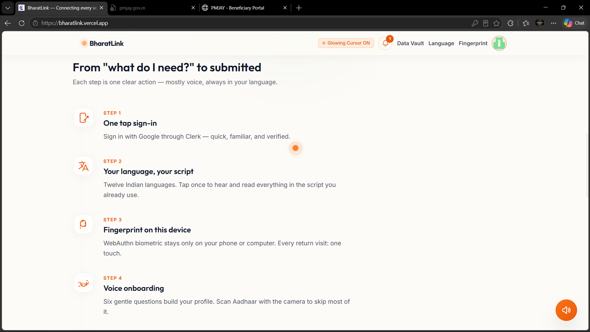
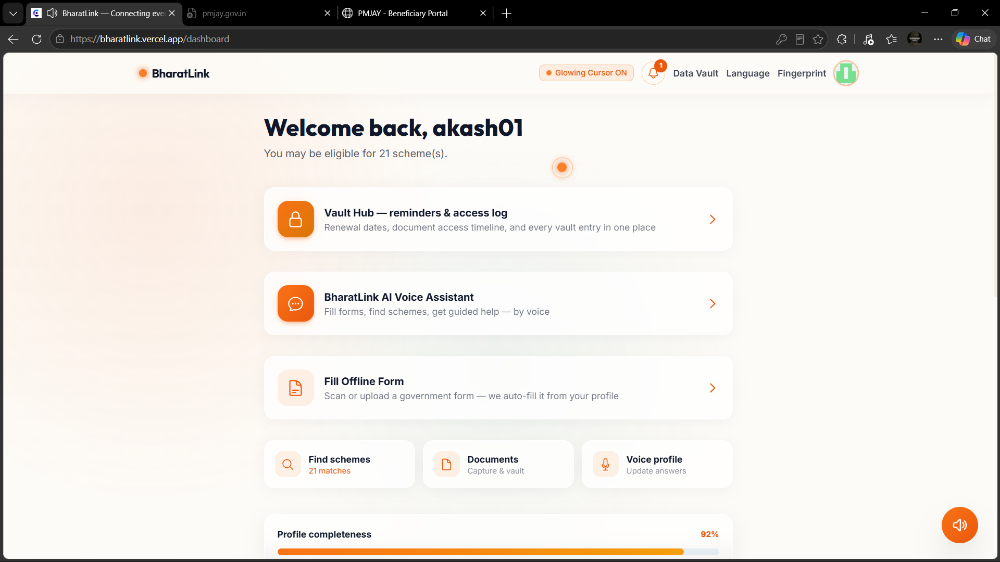
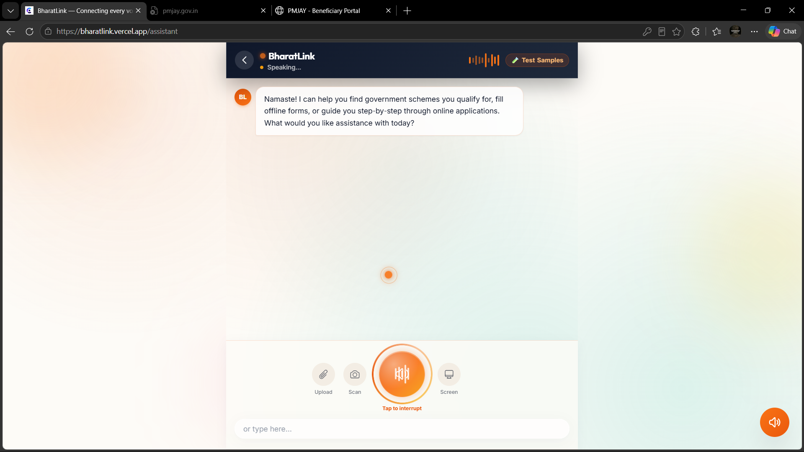
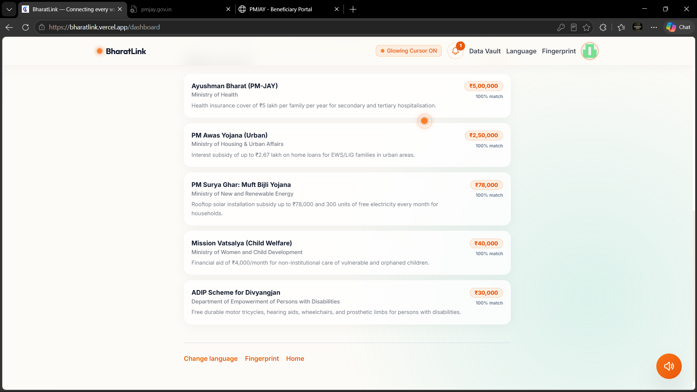
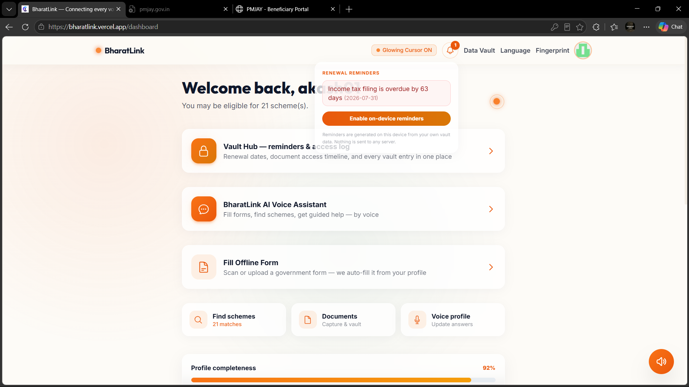
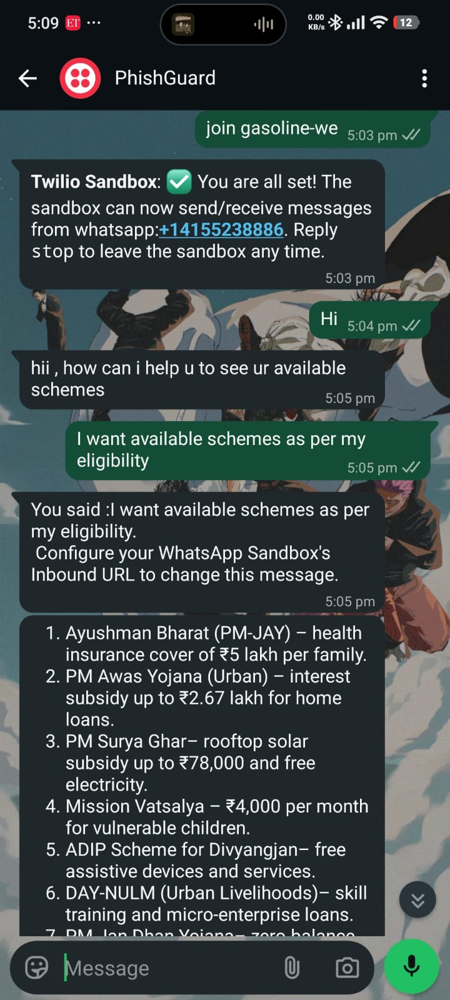
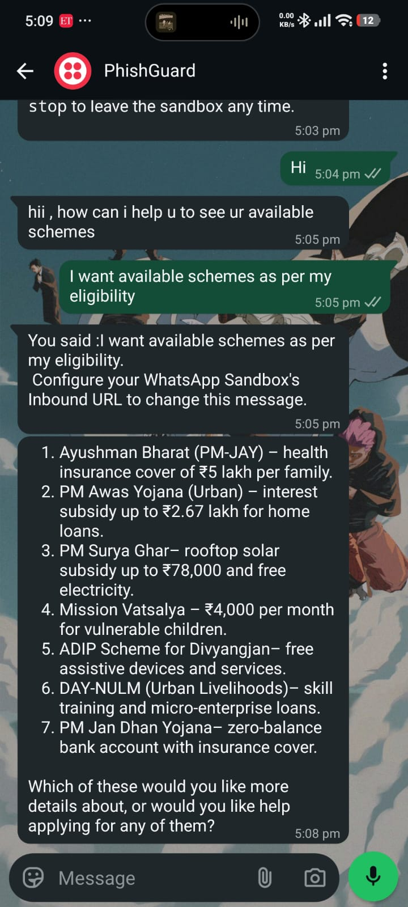

# BharatLink

> **Government services, in your language — driven by an AI that acts, not just answers.**

BharatLink is an agentic AI assistant purpose-built for India's citizens. It helps people discover welfare schemes they qualify for, fill paper and digital government forms, and complete online applications — entirely through **voice**, in **13 Indian languages**.


## 🌐 Try it live

**https://bharatlink.vercel.app**

---

## Screenshot Gallery

| Landing page | Dashboard | AI voice assistant |
|:---:|:---:|:---:|
|  |  |  |

| Eligible schemes | Renewal reminders + Vault Hub |
|:---:|:---:|
|  |  |

---

## The Problem

Over 100 million Indians are eligible for government welfare programs but never access them. The barriers are real: forms only exist in languages many can't read, portal websites are designed for bureaucrats not citizens, and the eligibility rules are buried in policy documents nobody has time to decode.

BharatLink eliminates all of those barriers at once — using an AI agent that speaks your language, reads your documents, matches you to schemes, and walks you through applications step by step.

---

## How It Works

A single voice message kicks off a **server-side agentic loop** with a self-healing multi-brain chain:

1. Your message (spoken or typed) arrives at the Next.js API route
2. The **brain chain** reasons about what needs to happen — first success wins:
   - **Google Gemini** (native function-calling; primary provider)
   - **OpenRouter** (GPT-4o-mini) — fallback
   - **Groq** (GPT-OSS 120B) — free, LPU-fast
   - **NVIDIA NIM** (Kimi K3)
   - **Local Ollama** — offline resilience
3. The model calls any combination of **19 purpose-built tools** — scanning a document, checking scheme eligibility, filling a PDF, generating it with self-verification, or narrating portal steps
4. Tool results feed back into the model, which decides whether to call more tools or respond — streamed **live to the UI** as action events
5. The final answer is spoken aloud in your language via **Sarvam Priya** (native Indic voices)

If any brain is down (out of credits, rate-limited, quota exhausted), the next one takes over automatically — **the assistant never goes silent**, and raw provider errors never reach the user.

One question like *"What housing schemes am I eligible for and how do I apply?"* might trigger 5 tool calls: read profile → match schemes → get scheme details → open portal → narrate steps. You just listen.

---

## Key Features

### 🗣 Talk in Your Language
13 Indian languages, voice in and voice out. Speech recognition by **Groq Whisper**, spoken replies in native Indic voices by **Sarvam Bulbul**. Pick your language once — every screen, every reply switches.

### 🧠 An Agent That Acts
19 purpose-built tools let the agent search current official government schemes against your profile and vault documents, open verified portals, extract form fields from a photo, fill them from your encrypted vault, and narrate exactly what to type on government websites.

### 🔐 A Document-Driven Vault
Save document scans or enter document details manually in the encrypted vault. Scheme discovery stays hidden until a document is saved, then searches current official government sources using the document types and broad profile details. Every suggestion links to its government source and is presented as a potential match, not a confirmed eligibility decision.

### 🧭 Document-First Onboarding
After sign-in, add a document by upload, camera, or manual entry; then create a profile for yourself or a family member with occupation and location details. Step 3 displays the number of potential matches, lists the source-backed schemes, and lets users filter Central and State/UT results before asking the assistant to explain them and supported application steps. BharatLink uses the selected person's profile and associated document types for discovery. Search sends broad eligibility attributes, not document images or direct identifiers. A source URL is checked to be an official government domain, but the AI-provided evidence excerpt and eligibility interpretation are not independently legally verified—open the source and confirm current rules before applying.

The onboarding form asks for age, occupation, annual household income, and state/district, with follow-up questions that vary for students, farmers, homemakers, workers, and retirees. The state/district selector uses the MIT-licensed location dataset in `src/lib/india-states-districts.json` (source: [Sanjay Kumar Nishad's Indian-States-And-Districts](https://github.com/sanjaynishad/Indian-States-And-Districts); license notice: `src/lib/india-states-districts.LICENSE`). A document number is required in manual entry and onboarding, encrypted in the device vault, and deliberately excluded from AI scheme-search payloads.

### 📄 Forms → Filled PDFs, Verified
Upload or photograph any government form. The agent detects the language, extracts every field, auto-fills from your profile, and generates a completed PDF — then **reads the PDF back and verifies** every field it wrote.

### 🎯 Multi-Step Missions
Give it a big goal — *"apply for PM-KISAN end to end"* — and the agent plans the steps, shows a live progress checklist, and works through them across turns.

### 📇 Aadhaar & Document Scanning
Point your camera at any ID or form. Vision AI extracts the details (with exact name transcription — no guessing), and everything saves to your encrypted on-device vault.

### 💬 WhatsApp Assistant
The same agent replies on **WhatsApp** — text and even **voice notes** (transcribed automatically). Great for feature phones and sharing.

### 🔔 Vault Hub — Reminders & Access Log
Renewal bell alerts you before deadlines (LPG KYC, tax filing, insurance premiums). A **Security & Access Log** shows every time any part of the app read your data — metadata only, never the values.

### 🔒 Privacy by Design
The profile vault is **AES-GCM encrypted** and stored in your browser's IndexedDB. Scheme search sends only broad eligibility attributes (such as state, age/income range, occupation, and document types) to the official MyScheme catalogue or a configured AI fallback; document images, names, contact details, Aadhaar numbers, and bank details are excluded. Catalogue results come from MyScheme; AI results must include official government citations. The encryption key lives on your device — clear it and the vault is gone by design.

---

## 💬 WhatsApp in Action

A real conversation with the live bot — user asks in plain language, the agent replies with schemes matched to their profile, formatted for WhatsApp:

| Conversation | Full reply |
|:---:|:---:|
|  |  |

**Transcript:**

> **User:** Hi
>
> **BharatLink:** Hii, how can I help you to see your available schemes?
>
> **User:** I want available schemes as per my eligibility
>
> **BharatLink:** 1. **Ayushman Bharat (PM-JAY)** — health insurance cover of ₹5 lakh per family. 2. **PM Awas Yojana (Urban)** — interest subsidy up to ₹2.67 lakh for home loans. 3. **PM Surya Ghar** — rooftop solar subsidy up to ₹78,000 and free electricity. 4. **Mission Vatsalya** — ₹4,000 per month for vulnerable children. 5. **ADIP Scheme for Divyangjan** — free assistive devices and services. 6. **DAY-NULM (Urban Livelihoods)** — skill training and micro-enterprise loans. 7. **PM Jan Dhan Yojana** — zero-balance bank account with insurance cover.
>
> *Which of these would you like more details about, or would you like help applying for any of them?*

## WhatsApp Chatbot Setup

BharatLink's agent also answers on WhatsApp (text + voice notes). The webhook is live at:

```
https://<your-deployed-domain>/api/whatsapp/webhook
```

**Easiest path — Twilio WhatsApp Sandbox (free):**

1. Sign up at [console.twilio.com](https://console.twilio.com) → **Messaging → Try it out → Send a WhatsApp message**
2. Join the sandbox from your phone (send the shown code to the sandbox number)
3. In the sandbox settings, set **"When a message comes in"** to:
   ```
   https://your-domain.vercel.app/api/whatsapp/webhook   (method: POST)
   ```
4. Message the sandbox number: *"What schemes can a farmer with 2 acres get?"* — the agent replies right in WhatsApp, with scheme details formatted for chat.

Voice notes work too — they're transcribed with Groq Whisper before the agent sees them.

---

## Tech Stack

| Layer | Technology |
|---|---|
| **Framework** | Next.js 15 (App Router), TypeScript 5.7, React 19 |
| **Agent brain chain** | Google Gemini function-calling → OpenRouter (GPT-4o-mini) → Groq (GPT-OSS 120B) → NVIDIA NIM (Kimi K3) → local Ollama |
| **Speech-to-text** | Groq Whisper large-v3 (browser Web Speech as first try) |
| **Text-to-speech** | Sarvam Bulbul v3 (native Indic voices) → OpenAI GPT-Audio → browser voices |
| **Vision (OCR / forms / PDFs)** | Gemini + GPT-4o-mini with token caps and model failover |
| **PDF engine** | pdf-lib + @pdf-lib/fontkit (AcroForm fill + overlay + summary) |
| **Auth** | Clerk (Google OAuth, WebAuthn biometric) |
| **Encryption** | Web Crypto AES-GCM, device-bound keys, IndexedDB |
| **Internationalisation** | i18next — 13 languages, native scripts |
| **Styling** | Tailwind CSS 3 — Coral & Slate glassmorphism |
| **Testing** | Playwright + built-in QA suite (`node scripts/final-qa.mjs`) |

---

## Privacy & Security

- **Vault data stays on your device.** Profile fields and document images are AES-GCM encrypted in IndexedDB.
- **Scheme discovery uses minimized data.** Broad profile attributes are used to query the official MyScheme catalogue first; if that catalogue is unavailable or has no matches, configured AI providers can search for additional official-source-backed leads. Document numbers, names, contact details, and document images are not included in scheme searches.
- **The encryption key lives in localStorage.** If you clear it, the data is permanently unrecoverable — by design.
- **Document images** are sent to the vision API to extract text, then immediately discarded. Nothing is persisted server-side.
- **No server-side profile database.** API routes do not store profile or document data. Clerk stores the preferred-language setting, which is cleared for an account when it starts a fresh app session.
- **Fresh start between accounts.** On an account's first session in a browser, and on sign-out, BharatLink clears its local profile vault, vault access log, language/onboarding state, and app preferences so another account starts cleanly.
- **In-app access log** records every vault read/write (metadata only — never values) so you can audit the app itself.

---

## Getting Started

### Prerequisites

- Node.js 18+
- API keys: Clerk; [GroqCloud](https://console.groq.com/keys) and [Google AI Studio](https://aistudio.google.com/apikey) enable AI fallback providers for scheme search and assistant features; optional: [OpenRouter](https://openrouter.ai/keys), [Sarvam AI](https://dashboard.sarvam.ai)
- Optional: [NVIDIA NIM](https://build.nvidia.com) key, a local [Ollama](https://ollama.com) install

### Setup

```bash
git clone https://github.com/okegy/Bharat.AI.git
cd Bharat.AI
npm install
```

Copy the env example and fill in your keys:

```bash
cp .env.example .env.local
```

```env
NEXT_PUBLIC_CLERK_PUBLISHABLE_KEY=pk_test_...
CLERK_SECRET_KEY=sk_test_...
GROQ_API_KEY=gsk_...
GEMINI_API_KEY=...
# GOOGLE_API_KEY is also accepted instead of GEMINI_API_KEY.
SARVAM_API_KEY=...
# Optional extras:
OPENROUTER_API_KEY=sk-or-v1-...
NVIDIA_API_KEY=nvapi-...
OLLAMA_URL=http://localhost:11434
```

```bash
npm run dev
```

Open [http://localhost:3000](http://localhost:3000).

> In-app scheme discovery queries the live official [MyScheme catalogue](https://www.myscheme.gov.in/search) first and displays its matching catalogue entries. If the catalogue is temporarily unavailable or returns no matches, it falls back to Groq's browser-search tool (`openai/gpt-oss-120b`, then `openai/gpt-oss-20b`), Gemini, or OpenRouter when configured. Provider free-tier quotas may apply. Add more Groq keys as `GROQ_API_KEY_2`, `GROQ_API_KEY_3`, etc.

---

## Supported Schemes (50+)

Ration Card (NFSA) · PM-KISAN · PM Fasal Bima Yojana · PM Awas Yojana (Urban + Rural) · Ayushman Bharat PM-JAY · PM Surya Ghar: Muft Bijli · Sukanya Samriddhi Yojana · PM Matru Vandana Yojana · National Pension Scheme · PM Ujjwala Yojana · National Scholarship Portal · PM Mudra Yojana · Mission Vatsalya · ADIP Scheme for Divyangjan · Skill India Mission · and many more across agriculture, health, housing, education, and employment.

---

## License

[MIT](./LICENSE) © 2026 okegy
